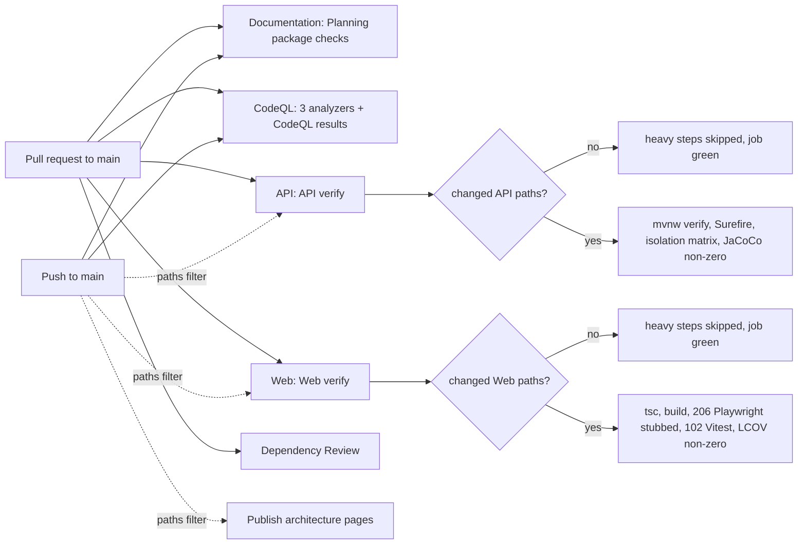

# CI/CD, DevSecOps and software quality audit

Updated: 2026-11-25. Owner: Aymen Chaghoub. Audit baseline: `main` at `7980407125e9202b26b3f4b813b06f48c39a5d51` (PR #72). Status: **initial audit, written before any implementation change**. The implementation outcome, the after-scorecard and the validation evidence are appended below once they exist.

This audit challenges the pipeline; it does not describe it favorably. A green check is treated as a claim that needs evidence. Labels follow AGENTS.md: **User decision**, **Verified observation**, **Proposal**, **[ASSUMPTION]**, **To verify**.

## 1. Authority and scope

**User decision (mission brief, 2026-11-25).** Aymen asked for an independent CI/CD, DevSecOps and quality audit, followed by justified implementation, validation, an independent self-review and a pull request left unmerged. Authorized: repository-side CI, build, quality-tooling and security-automation changes, the tests those changes need, and their documentation. Not authorized: product features, business rules, UX or architecture changes, story authorization, remote settings (ruleset, required checks, permissions, secrets, environments, integrations), paid services, deployment, merging or auto-merge.

No application behavior, `_bmad/custom/config.toml` entry or remote setting is changed by this work. Owner-controlled changes are written as proposals in [section 11](#11-decisions-and-remote-changes-that-need-the-owner).

## 2. Baseline and evidence

**Verified observation.** Principal checkout clean on `main` = `origin/main` = `7980407`; one worktree; no open pull request; branches `feat/…`, `docs/…`, `ci/…` already exist locally and were left untouched. The work runs in a dedicated worktree on `chore/ci-quality-hardening` created from `origin/main`.

**Sources read in full:** the six workflows, `.github/dependabot.yml`, the three CodeQL configs, the pull request template, `.gitleaks.toml`, `.coderabbit.yaml`, `.pr_agent.toml`, `apps/api/pom.xml` and its Maven wrapper properties, `apps/web/package.json`, `tsconfig*.json`, the Vitest and the three Playwright configs, `package.json`, `pnpm-workspace.yaml`, `tools/assert_test_reports.py`, `tools/assert_coverage_reports.py`, `tools/check_doc_workflow.py`, `tools/run_secret_scan.sh`, `tools/generate_web_tokens.py`, the demo and local Docker/Compose files, [GitHub security](github-security.md), [delivery rules](delivery-rules.md), the [CI/CD strategy](cicd-deployment-strategy.md), the test strategy, ADR-002 and ADR-007, deferred items D-29, D-33, D-40, D-55 and D-56, UD-47 and UD-49, and the continuation record of PR #72.

**GitHub evidence** (authenticated `gh`, 2026-11-25):

- 779 workflow runs created since 2026-11-11, including 752 runs of the six workflows whose jobs and steps were fetched. Per job: 96 `API verify` and 97 `Web verify` runs on pull requests, 17 each on `main`.
- Ruleset 26390376 (read back): see [section 3](#3-pipeline-as-it-is). Actions permissions: selected actions only (GitHub-owned and `astral-sh/setup-uv@*`), `sha_pinning_required: true`; default token permission `read`; pull request approval by Actions disabled; fork pull request approval for first-time contributors. Squash merge only, auto-merge off, branch deletion on merge. No repository or environment secret, no variable. Environments: `github-pages` (branch policy) and an unprotected unused `copilot`.
- Security state: 0 open Dependabot alerts, 0 open code-scanning alerts, 0 open secret-scanning alerts; secret scanning and push protection enabled; Dependabot security updates enabled; code scanning default setup `not-configured` (the repository uses its own workflow).
- Sample of the latest run per pull request branch (see the run table in [section 4](#4-measured-metrics)): documentation-only, API-only, Web-only, mixed, dependency (Dependabot), infrastructure (`ci/…`) and tooling changes are all represented.

**Access limits.** Branch protection REST read returns 404 because the repository uses a ruleset (expected). Code-scanning alert history was read for state only. No Sonar account, token or app exists and none was created. Figma was not needed.

**Local toolchain used for measurements:** Java 25 (`/usr/lib/jvm/java-25-openjdk`), Node 26.13.1, pnpm 12.21.0, Docker 29.9.3, Python 3.14. The default `java` on this host is 21 and `node` is 22; the measurements used the project versions.

## 3. Pipeline as it is

**Required on `main` (ruleset 26390376, strict up-to-date, zero approvals, no bypass actor, squash, linear history, thread resolution):** `Planning package checks`, `Analyze tooling`, `Analyze API (Java)`, `Analyze Web (TypeScript)`, `CodeQL` (GitHub code scanning results, app 57789), `API verify`, `Web verify`. Not required: `Dependency review`, `Publish architecture documentation`.

**Delivery.** The only automated publication is the GitHub Pages site of the architecture views. No application artifact is built, versioned, scanned, attested or published by CI, so the project implements continuous integration only; it implements neither continuous delivery nor continuous deployment.

**Strengths (Verified observation):** every action is pinned to a full SHA and the repository enforces it; least-privilege `permissions` on every workflow; `persist-credentials: false` everywhere; timeouts and concurrency groups on every job; a required check always starts (no `paths` filter on pull requests) and decides internally; the changed-path step fails closed on any Git error; the Maven distribution and the Gitleaks binary are checksum-verified; Python tooling is hash-locked; `tools/assert_test_reports.py` rejects zero-test, skipped, duplicated, malformed or entity-bearing reports and requires named suites; the adversarial isolation matrix of story 1.4 is measured in CI; there is no `continue-on-error`, no `pull_request_target` and no secret use; Playwright runs with `retries: 0`, so no flake is hidden. Both `actionlint` 1.7.12 (with ShellCheck) and `zizmor` 1.33.1 report no error, warning or security finding on the six workflows.

## 4. Measured metrics

| Metric | Value | Source |
|---|---|---|
| API tests | 259, 0 failed, 0 skipped; `assert_test_reports.py surefire` passes | local `./mvnw -B -ntp verify`, Java 25, 2 m 02 s |
| API line / branch coverage | 2,064 / 2,307 = **89.47 %**; 717 / 910 = **78.8 %** (instructions 91.5 %, methods 88.9 %) | same run, `jacoco.xml` |
| API packages under 50 % lines | `identity.recovery` (the demo-only `LocalRecoveryInbox`, 0 / 64), `audit.domain` (entity, 0 / 24), `communications.domain` (0 / 12), `practices.domain` (43.5 %) | same |
| API security-relevant packages | `infrastructure.security` 93.8 % lines / 77.3 % branches; `infrastructure.transaction` 98.5 / 86.4; `records.service` 96.8 / 95.2; `records.domain` 98.8 / 90.5; `identity.service` 91.8 / 83.3 | same |
| Web unit tests | 102 passed; Playwright smoke 206 passed (CI, `main` run 45681909896 at `7980407`) | CI log |
| Web unit line / branch coverage | 447 / 2,380 = **18.78 %**; 434 / 2,697 = **16.09 %** | local and CI agree |
| Web coverage by kind | the pure rule modules read 80–100 % (`measurements.ts` 96.9 %, `asof.ts` 98.5 %, `isolation-journey.ts` 97.2 %, `evidence.ts` 80.3 %, `date.ts` 100 %); all 16 page and component `.tsx` files read **0 %** because browser tests drive them and no browser coverage is collected | local lcov |
| Runtime (14 days, successful full runs on `main` and PRs) | `API verify` median 119 s (max 161 s); `Web verify` median 202 s (max 637 s: one 517 s Chromium installation); light runs (no relevant path) 0.1 min; CodeQL jobs 59–106 s; `Planning package checks` 29 s | job and step data |
| Outcome mix, 14 days | `API verify` and `Web verify`: 36 and 33 pull request runs skipped their heavy steps; failures: 2 API (Testcontainers), 1 Web (a stale-version flake of a 3.1 spec), 10 `Planning package checks` (4 Gitleaks catches, 6 whitespace or policy), 5 CodeQL upload failures during the GitHub incident of 2026-11-25 and a Dependabot bump | job data |
| Dependabot | 3 security-update jobs for `js-yaml` ended `security_update_not_possible` on 2026-11-20; the 3 alerts were later fixed (alerts 55–57); version-update PRs exist only for Actions and two pip directories | run log, alerts |

**Sample of the latest run per pull request branch** (API / Web heavy steps): `docs/*` (6 branches): skipped / skipped; `feat/3.3`, `feat/3.2`, `feat/3.1`, `feat/1.4`, `ci/quality-checks`: full / full; `ci/cd-improvements` (PR #72): skipped / full; `dependabot/actions/setup-java`: full / skipped; `dependabot/actions/codeql-action`, `setup-uv`, `pip/*`: skipped / skipped. These are consistent with the current path lists. They do not prove the lists are complete; CI-02 explains why completeness depends on discipline, not construction.

## 5. Findings

Severity follows impact on trust in a green result. Complexity: S small, M medium, L large.

### CI-01 — The coverage gate cannot fail on a real regression

- **Severity:** High (false-green: the check name promises a quality gate it does not provide). **Priority:** P1.
- **Where:** `tools/assert_coverage_reports.py:49-50` fails only when zero lines are covered; `apps/api/pom.xml:99-121` binds JaCoCo `prepare-agent` and `report` only (no `check`); `apps/web/vitest.config.ts:5-11` defines no `thresholds`; `.github/workflows/api.yml:120-122`, `web.yml:132-137`.
- **Evidence:** API 89.47 % lines, Web 18.78 % lines. A pull request that adds 500 untested API lines, or drops the Web rule modules from 97 % to 1 %, still passes `Verify API coverage report` and `Verify Web coverage report`. Nothing checks the coverage of changed code.
- **Impact:** coverage is decorative; the 80 % new-code target in the [strategy](cicd-deployment-strategy.md#coverage-and-dependency-checks) is a sentence, not a control. The AI-assisted development loop that this project runs depends on strong gates.
- **Correction:** enforce floors in the native tools so local and CI behavior match (JaCoCo `check` with a bundle floor and floors on the security packages; Vitest `thresholds` with a floor on the rule modules), and add a changed-line coverage gate that compares the diff with the JaCoCo and LCOV reports. Keep integrity checks in the Python validator. **Complexity:** M.
- **Validation:** failing, boundary, malformed and missing-report cases for each gate; replay of the new-code gate on the story 3.3 diff. **Residual risk:** coverage proves execution, not correct assertions; browser-driven `.tsx` files stay unmeasured (see CI-16).

### CI-02 — Change detection is duplicated, hand-listed and positive

- **Severity:** Medium (no bypass exists today; the design makes one likely). **Priority:** P1.
- **Where:** `api.yml:10-15` and `42-44`; `web.yml:11-36` and `64-74`; `dependency-review.yml:34-35`. Four hand-maintained copies of two path lists, plus a third list in the Dependency review step.
- **Evidence:** the previous audit (PR #72) found two Web inputs missing from both copies. I rebuilt the dependency map from the sources (Vite imports of `design/…` logos and `icons.css`, `generate_web_tokens.py` inputs, `openapi.config.mjs`, the isolation manifest read by a Vitest file, the licence copy in `package.json`) and found the current lists complete. A positive list still fails silently for any new input: a root `eslint.config.js`, `.npmrc`, `.node-version`, `vitest.workspace.ts` or a new shared script is not matched, so a pull request touching only it skips the Web build. The `push` filter is a fifth place to forget, and it also skips post-merge verification.
- **Impact:** a silent bypass of a required check, the failure class the project's own fail-closed comment warns about.
- **Correction:** one classifier with ordered rules where every path is `api`, `web`, shared, explicitly ignored or **unknown, and unknown runs everything**; one hygiene test that fails when a tracked file is unclassified; the same classifier for pull requests and pushes (a squash commit's first parent is the previous tip); no `paths` filter on `push`. **Complexity:** M.
- **Validation:** scenario matrix (API-only, Web-only, contract, migration, shared TypeScript config, lockfile, tokens and icons, isolation manifest, the scripts themselves, Docker and Compose, documentation-only, failed diff, missing history, renamed and deleted files). **Residual risk:** a path that is *ignored by mistake*; mitigated by the hygiene test and by listing only content known not to be consumed.

### CI-03 — The workflow policy validator audits three of six workflows by snapshot

- **Severity:** Medium. **Priority:** P1.
- **Where:** `tools/check_doc_workflow.py` references `documentation.yml`, `codeql.yml` and `architecture-pages.yml` only, asserts exact job-name sets and exact permission dictionaries, and uses bare `assert` (skipped under `python -O`). `api.yml`, `web.yml` and `dependency-review.yml` are never checked: an unpinned action, `pull_request_target`, `continue-on-error`, a missing timeout or a script-injection pattern added there passes this check.
- **Evidence:** `grep` for the three names in `tools/check_doc_workflow.py` returns nothing. The remote SHA-pinning setting is the only backstop for pinning; nothing guards the other invariants. Adding a workflow also requires editing the fixed list in `tools/validate_docs.py:128-131`.
- **Impact:** policy regressions in the two largest workflows are not detected; a renamed job would orphan a required check and block every merge without any local warning.
- **Correction:** an invariant-based validator over every file in `.github/workflows/` (new workflows covered automatically), with tests that fail on each invariant; `actionlint` and `zizmor` for syntax and security analysis. Keep the existing snapshot checks, which protect other decisions. **Complexity:** M.

### CI-04 — No frontend linting

- **Severity:** Medium (to be re-rated after the trial in [section 8](#8-evaluations)). **Priority:** P1.
- **Where:** `apps/web/package.json` has no ESLint, no React Hooks rules, no accessibility rules, no floating-promise rule; `tsc` is the only static check besides CodeQL.
- **Evidence:** 16 `.tsx` components, asynchronous session and record flows, React Aria components (ADR-013) and a stated accessibility requirement. CodeQL does not check Hooks dependency arrays, floating promises or ARIA misuse.
- **Correction:** a curated flat ESLint configuration (correctness, React Hooks, accessibility, promise handling) with zero accepted violations on day one, narrow generated-code exclusions and no formatting rules. **Complexity:** M.

### CI-05 — Backend toolchain and dependency rules are not enforced; static analysis stops at CodeQL

- **Severity:** Low. **Priority:** P2.
- **Where:** `apps/api/pom.xml` has no Enforcer: Java 25, Maven 3.9.11, duplicate dependency versions, plugin version pinning and convergence are unchecked. The default compile emits no warnings (baseline log), but `-Xlint` is not enabled.
- **Impact:** a developer on Java 21 gets an opaque error or, worse, a build on the wrong runtime; the CI image decides. [To verify: Enforcer convergence on the Spring Boot BOM, SpotBugs and PMD signal on Java 25; see section 8.]

### CI-06 — Real-stack journeys and API/contract conformance are not verified in CI

- **Severity:** Medium (known and recorded as D-56). **Priority:** P1.
- **Where:** `apps/web/e2e/*.spec.ts` and `apps/web/demo-e2e/*.spec.ts` run only by hand; nothing reads `docs/contracts/openapi.yaml` on the API side (`grep openapi apps/api` returns one comment).
- **Evidence:** the 206 browser tests run against stubbed responses typed by the generated SDK; the 259 API tests are hand-written. The only evidence that the stubs match the real API is the manual real-stack run recorded in each story. The API matrix proves the server boundary in CI; sign-in, session, CSRF, practice context and a cross-practice denial through the real browser are not.
- **Correction:** a focused real-stack job on the demo package (non-required first, as D-56 proposes), with deterministic fixtures only and failure diagnostics. Contract conformance tests are larger work and are deferred with a trigger. **Complexity:** L.

### CI-07 — The delivery package and the role provisioning script are never exercised by CI

- **Severity:** Medium. **Priority:** P1.
- **Where:** `infra/demo/*.Dockerfile`, `infra/demo/compose.yml`, `infra/local/init-roles.sh`, `infra/local/verify-init-roles.sh`.
- **Evidence:** the API tests re-create the three roles in test code (`apps/api/src/test/java/dev/aymen/etaye/AbstractPostgresTest.java:52-58`) instead of running `init-roles.sh`; `verify-init-roles.sh` (five cases: attributes, collision refusal, literal password, Compose settings, health follows drift) is referenced by AGENTS.md and a story record but by no workflow. A regression in the script that grants `BYPASSRLS` or ownership would keep CI green while the demo and local stacks lose the row-level-security foundation. No workflow builds the four images, so a broken Dockerfile or Compose file is found only by hand. Base images use floating tags (`postgres:18`, `eclipse-temurin:25-jdk`/`-jre`, `node:26-bookworm-slim`, `nginx:1.28-alpine`, `flyway/flyway:12.4.0`); a Trivy scan of the pulled tags on 2026-11-25 reported 85 fixable high or critical findings in `nginx:1.28-alpine`, 2 in `postgres:18` (plus 26 on its bundled `gosu`), 7 OS findings in the Flyway image and 0 in `eclipse-temurin:25-jre`; the built API jar had 0 high or critical findings.
- **Impact:** the delivery package is an unverified artifact; the security-critical provisioning script has only manual evidence.
- **Correction:** run the role-script verifier, build the four images and start the stack in CI on infrastructure changes and on pushes; pin base images by digest with Dependabot updates; scan images report-only with a documented policy. **Complexity:** M–L.

### CI-08 — Dependency update and vulnerability coverage has gaps

- **Severity:** Medium. **Priority:** P1.
- **Where:** `.github/dependabot.yml` covers `github-actions` and two `pip` directories only.
- **Evidence:** no version-update coverage for npm (pnpm), Maven, Docker or Docker Compose; pnpm and Maven carry the application's runtime dependencies. The dependency graph reads `pom.xml` statically, so versions managed by the Spring Boot BOM do not appear, which is already stated in the strategy; `actions/dependency-review-action` and Dependabot alerts cannot see them. Dependabot's `js-yaml` security-update job failed three times on 2026-11-20 (`security_update_not_possible`) and was resolved by hand through a pnpm override.
- **Correction:** add the four ecosystems with grouping, cooldown-free security updates and a PR limit; check the shipped jar for known high or critical advisories in a job that needs no Maven Central resolution (Trivy resolved `pom.xml` against Maven Central and was rate-limited with HTTP 429 and `Retry-After: 1800` during this audit, so a `pom.xml` scan is not reliable in CI). **Complexity:** M.

### CI-09 — `Dependency review` is not a required check

- **Severity:** Low. **Priority:** P2 (owner decision; remote setting).
- **Evidence:** it starts on every pull request to `main` (72 successes, 19 cancellations by concurrency in 14 days) and checks new high or critical advisories; a merge with a failing result is still allowed. The strategy already states the condition for requiring it ("after a successful run is observed"), which is met.

### CI-10 — Reproducibility gaps

- **Severity:** Low. **Priority:** P2.
- **Evidence:** `npm install --global corepack@0.36.0` runs outside any lockfile in `web.yml:87`, `dependency-review.yml:47` and `infra/demo/web.Dockerfile:4` (also reported by zizmor as `adhoc-packages`); `package.json` pins `pnpm@12.21.0` without an integrity hash; Node `'26'` is repeated in three workflows and a Dockerfile; Docker tags float (CI-07); the API jar has no `project.build.outputTimestamp`, so two builds of the same commit differ (no release artifact exists yet, so this has no effect today).

### CI-11 — Browser failures leave no diagnostics

- **Severity:** Low. **Priority:** P2.
- **Evidence:** `apps/web/playwright.config.ts` sets no `trace` or `screenshot`; the workflow uploads `smoke.json` only. On 2026-11-23 a failed `Web verify` (the stale-version flake of a 3.1 spec) left only the JSON report; the passing-alone rerun could not be explained from artifacts. Retries stay at 0 (correct).

### CI-12 — A newer merge cancels the post-merge run of the previous one

- **Severity:** Low. **Priority:** P2. **Evidence:** `cancel-in-progress: true` on `api`, `web`, `codeql` and `documentation` groups keyed by `github.ref`; two merges to `main` within the job duration cancel the first run's verification. No cancelled `push` run exists in the 14-day data, so this is a latent risk, not an observed loss.

### CI-13 — Small hygiene items

- **Severity:** Informational. `.github/workflows/codeql.yml:25,48,79` pin `actions/checkout` without a version comment (zizmor `ref-version-mismatch`); permission lines carry no explanatory comment; `.github/workflows/architecture-pages.yml:18` job has no `name`.

### CI-14 — No release, promotion, SBOM or provenance

- **Severity:** Informational. **Priority:** P3. There is no deployment target and no registry; ADR-007 and D-29 already defer promotion, signing and rollback. Generating attestations for artifacts nobody consumes would be decoration; see [section 9](#9-priorities).

### CI-15 — Local verification diverges from CI

- **Severity:** Low. **Priority:** P2. **Evidence:** the documented `./mvnw -B -ntp verify` passes without the coverage floors and the report checks that CI adds; the whitespace check (`git diff --check`) and the workflow policy run only in CI (six `Planning package checks` failures in 14 days, one a trailing blank line in `ChronologyPage.tsx`); no single page lists the commands to run before a pull request.

### CI-16 — Browser tests contribute no coverage measure

- **Severity:** Low. **Priority:** P3. The 206 Playwright tests drive every `.tsx` file but no V8 coverage is collected from them. Merging browser and unit coverage is possible but adds a moving part; the changed-line gate therefore applies to logic modules and the limit is documented, not hidden.

## 6. Hypotheses from the brief

| Hypothesis | Result |
|---|---|
| Coverage checks only assert nonzero coverage | **Confirmed** (CI-01) |
| JaCoCo and Vitest lack thresholds | **Confirmed** |
| `Dependency review` is not required | **Confirmed**, low risk (CI-09) |
| Dependabot omits application ecosystems | **Confirmed** (CI-08) |
| Real-stack tests are not in the standard Web workflow | **Confirmed**, recorded as D-56 (CI-06) |
| Docker and demo packaging are unverified | **Confirmed** (CI-07), worse than hypothesized: the role script is only manually verified |
| Static analysis beyond CodeQL is insufficient | **Partly confirmed**: frontend lint is absent (CI-04); backend added value to be measured (CI-05) |
| Path filters and internal detection duplicate knowledge | **Confirmed**; lists currently complete, structure fragile (CI-02) |
| The policy checker does not audit all workflows | **Confirmed** (CI-03) |
| Delivery and promotion are not automated | **Confirmed** (CI-14); documentation publication is not deployment |
| Two to three minutes API, three to four minutes Web | **Confirmed** (median 2.0 and 3.4 minutes); no optimization is justified |

## 7. Scorecard before the changes

A 5 requires verified evidence of the control working and of its failure being detected.

| Dimension | Score | Justification |
|---|---|---|
| Workflow reliability | 3 | Fail-closed, pinned, bounded; four duplicated lists, push filter, partial policy audit |
| Build reproducibility | 3 | Checksummed Maven and Gitleaks, hash-locked Python, frozen pnpm; floating images, unlocked Corepack, no integrity hash |
| Backend quality | 3 | 259 tests, ArchUnit, isolation matrix, 89 % lines; no gate, no Enforcer |
| Frontend quality | 2 | Strict TypeScript, 102 + 206 tests, axe; no lint, 18.8 % unit lines |
| Test effectiveness | 3 | Strong report validators, no hidden retries, matrix in CI; real stack manual, mutation checks manual |
| Coverage enforcement | 1 | Reports exist and are parsed; nothing can fail on a regression |
| Application security | 3 | CodeQL security-and-quality on three languages, secret scanning, isolation tests; DAST declined (D-33) |
| Supply-chain security | 3 | Pinned actions enforced remotely, checksummed tools; version updates for 2 of 5 ecosystems, Maven transitives and images unscanned |
| Delivery readiness | 1 | CI only; the demo package is never built or started in CI |
| Developer experience | 3 | 2–3.5 minute checks, documented commands; CI-only checks, no single entry |
| Governance and maintainability | 3 | Strict ruleset, decision register, templates; snapshot validator, optional dependency review |

## 8. Evaluations

### SonarQube Cloud versus alternatives

Research by a read-only sub-agent on official Sonar pages (2026-11-25), spot-checked against the repository's own settings. Claims the agent could not confirm from an official page are marked **To verify**.

| | Strengthen native controls | SonarQube Cloud Free | Self-hosted Community Build |
|---|---|---|---|
| Cost and access | none | no card; needs a Sonar organization, the GitHub App, a token (**owner actions**) | server to host (4 GB RAM, 2 cores, PostgreSQL) |
| Public personal repo | yes | yes: unlimited public projects (OSS plan for personal accounts: **To verify**) | yes |
| Pull request analysis | in repository | only for pull requests targeting `main` | **not available** (main branch only) |
| Quality gate | any, ours | read-only "Sonar way" (new code: coverage ≥ 80 %, duplication ≤ 3 %, ratings A, hotspots reviewed); custom gates need a paid or OSS plan | custom gates |
| Monorepo | n/a | one project per component, all bound to the repository (three projects here) | not available |
| Java 25, TypeScript, Python | n/a | Java 25 supported; TypeScript up to 7, React 19 **To verify**; Python yes | yes |
| Scanner and allowlist | n/a | Maven plugin runs through the wrapper without a third-party action; the frontend needs a downloaded CLI (no documented checksum) or the third-party `SonarSource/sonarqube-scan-action`, which the repository's Actions allowlist blocks | n/a |
| Dependabot pull requests | n/a | no `SONAR_TOKEN` unless duplicated into Dependabot secrets | n/a |
| Overlap with CodeQL `security-and-quality` | n/a | large on security, additive on duplication, maintainability and hotspot review | same |

**Verdict (Proposal).** Strengthen the native controls now (this pull request); treat SonarQube Cloud Free as an **owner-activated option**, not a repository change. Reasons: it is genuinely free for this public repository, but nothing can be verified end to end without an account, an app installation and a token that only Aymen can create; it needs three monorepo projects; it blocks pull requests only through a read-only gate whose headline condition (80 % coverage on new code) this pull request already enforces vendor-independently; its official action is outside the allowlist; and committing an unverifiable workflow would add configured-but-unverified code to a required path. The runbook to activate it in about 15 minutes is in [section 11](#11-decisions-and-remote-changes-that-need-the-owner). Self-hosting is disproportionate and cannot gate pull requests.

### Scanners

- `actionlint` 1.7.12 and `zizmor` 1.33.1 find nothing blocking today, so their value is regression prevention at low cost: `zizmor` installs from PyPI into the existing hash-locked environment, `actionlint` ships with ShellCheck and a checksummed release.
- Trivy: useful on built images and on the shipped jar; unreliable on `pom.xml` (HTTP 429 from Maven Central, a 90 s Java database download on this host); the findings today are on third-party base images that Dependabot digest updates and a rebuild address, so a blocking gate would be red without an owner-side fix. It runs report-only with a stated policy.
- OSV-Scanner: not evaluated further; it resolves Maven transitives over the network as well and overlaps Trivy on the shipped jar.
- Frontend and backend lint, Enforcer, SpotBugs and PMD: measured in the implementation section.

## 9. Priorities

- **P0:** none. No bypass, no secret exposure and no broken build was found; the verification claims in the repository are accurate for what they check.
- **P1:** CI-01 coverage gates, CI-02 classifier, CI-03 policy validator, CI-04 frontend lint, CI-06 real-stack smoke (non-required), CI-07 delivery-package job and role-script verification, CI-08 Dependabot ecosystems and shipped-jar scan.
- **P2:** CI-05 Enforcer, CI-09 required `Dependency review` (owner), CI-10, CI-11, CI-12, CI-13, CI-15.
- **P3:** CI-14 release, SBOM, provenance and promotion (needs a deployment target); CI-16 merged browser coverage; contract-conformance tests; automated mutation testing; SonarQube Cloud activation.

## 10. Outcome

Appended after the implementation: see the sections below.

## 11. Decisions and remote changes that need the owner

Written before implementation; the detailed procedures (current state, proposed state, exact steps, expected effect, order, risks, rollback) are completed with the outcome.

1. Make `Dependency review` a required check (CI-09). Remote ruleset change.
2. Decide whether a new non-required real-stack and delivery-package check should later become required (CI-06, CI-07).
3. Activate SonarQube Cloud Free, or not (section 8). Needs a Sonar organization, the GitHub App installation and a token.
4. Allow any further third-party action only by an explicit Actions allowlist change; this work adds none.
