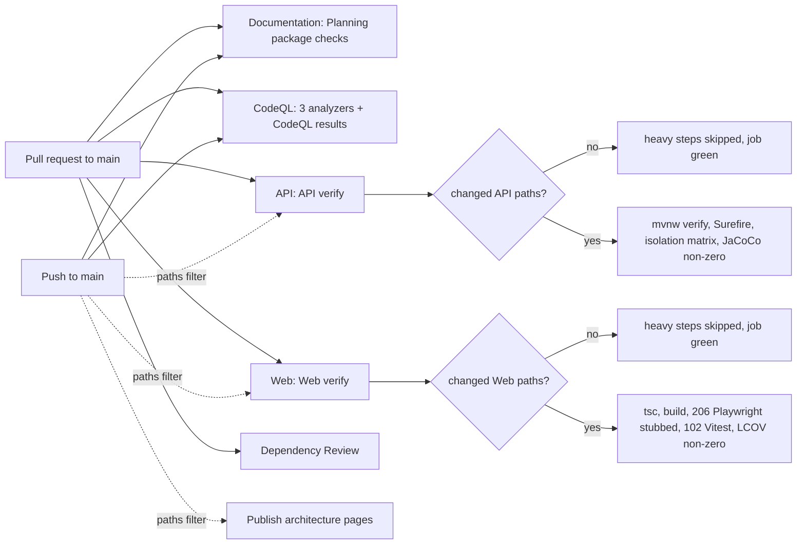

# CI/CD, DevSecOps and software quality audit

Updated: 2026-11-25. Owner: Aymen Chaghoub. Audit baseline: `main` at `7980407125e9202b26b3f4b813b06f48c39a5d51` (PR #72). Status: audit and implementation record. Sections 1 to 9 are the initial audit, written before any implementation change; sections 10 to 13 record the outcome, the validation evidence, the owner decisions and the review.

This audit challenges the pipeline; it does not describe it favorably. A green check is treated as a claim that needs evidence. Labels follow AGENTS.md: **User decision**, **Verified observation**, **Proposal**, **[ASSUMPTION]**, **To verify**.

## 1. Authority and scope

**User decision (mission brief, 2026-11-25).** Aymen asked for an independent CI/CD, DevSecOps and quality audit, followed by justified implementation, validation, an independent self-review and a pull request left unmerged. Authorized: repository-side CI, build, quality-tooling and security-automation changes, the tests those changes need, and their documentation. Not authorized: product features, business rules, UX or architecture changes, story authorization, remote settings (ruleset, required checks, permissions, secrets, environments, integrations), paid services, deployment, merging or auto-merge.

No application behavior, `_bmad/custom/config.toml` entry or remote setting is changed by this work. Owner-controlled changes are written as proposals in [section 11](#11-decisions-and-remote-changes-that-need-the-owner).

## 2. Baseline and evidence

**Verified observation.** Principal checkout clean on `main` = `origin/main` = `7980407`; one worktree; no open pull request; branches `feat/…`, `docs/…`, `ci/…` already exist locally and were left untouched. The work runs in a dedicated worktree on `chore/ci-quality-hardening` created from `origin/main`.

**Sources read in full:** the six workflows, `.github/dependabot.yml`, the three CodeQL configs, the pull request template, `.gitleaks.toml`, `.coderabbit.yaml`, `.pr_agent.toml`, `apps/api/pom.xml` and its Maven wrapper properties, `apps/web/package.json`, `tsconfig*.json`, the Vitest and the three Playwright configs, `package.json`, `pnpm-workspace.yaml`, `tools/assert_test_reports.py`, `tools/assert_coverage_reports.py`, `tools/check_doc_workflow.py`, `tools/run_secret_scan.sh`, `tools/generate_web_tokens.py`, the demo and local Docker/Compose files, [GitHub security](github-security.md), [delivery rules](delivery-rules.md), the [CI/CD strategy](cicd-deployment-strategy.md), the test strategy, ADR-002 and ADR-007, deferred items D-29, D-33, D-40, D-55 and D-56, UD-47 and UD-49, and the continuation record of PR #72.

**GitHub evidence** (authenticated `gh`, 2026-11-25):

- 779 workflow runs created since 2026-11-11, including 752 runs of the six workflows whose jobs and steps were fetched. Per job: 96 `API verify` and 97 `Web verify` runs on pull requests, 17 each on `main`.
- Ruleset 26390376 (read back): see [section 3](#3-pipeline-as-it-is). Actions permissions: selected actions only (GitHub-owned and `astral-sh/setup-uv@*`), `sha_pinning_required: true`; default token permission `read`; pull request approval by Actions disabled; fork pull request approval for first-time contributors. Squash merge only, auto-merge off, branch deletion on merge. No repository or environment secret, no variable. Environments: `github-pages` (branch policy) and an unprotected unused `copilot`.
- Security state: 0 open Dependabot alerts, 0 open code-scanning alerts, 0 open secret-scanning alerts; secret scanning and push protection enabled; Dependabot security updates enabled; code scanning default setup `not-configured` (the repository uses its own workflow).
- Sample of the latest run per pull request branch (see the run table in [section 4](#4-measured-metrics)): documentation-only, API-only, Web-only, mixed, dependency (Dependabot), infrastructure (`ci/…`) and tooling changes are all represented.

**Access limits.** Branch protection REST read returns 404 because the repository uses a ruleset (expected). Code-scanning alert history was read for state only. No Sonar account, token or app exists and none was created. Figma was not needed.

**Local toolchain used for measurements:** Java 25 (`/usr/lib/jvm/java-25-openjdk`), Node 26.13.1, pnpm 12.21.0, Docker 29.9.3, Python 3.14. The default `java` on this host is 21 and `node` is 22; the measurements used the project versions.

## 3. Pipeline as it is

**Required on `main` (ruleset 26390376, strict up-to-date, zero approvals, no bypass actor, squash, linear history, thread resolution):** `Planning package checks`, `Analyze tooling`, `Analyze API (Java)`, `Analyze Web (TypeScript)`, `CodeQL` (GitHub code scanning results, app 57789), `API verify`, `Web verify`. Not required: `Dependency review`, `Publish architecture documentation`.

**Delivery.** The only automated publication is the GitHub Pages site of the architecture views. No application artifact is built, versioned, scanned, attested or published by CI, so the project implements continuous integration only; it implements neither continuous delivery nor continuous deployment.

**Strengths (Verified observation):** every action is pinned to a full SHA and the repository enforces it; least-privilege `permissions` on every workflow; `persist-credentials: false` everywhere; timeouts and concurrency groups on every job; a required check always starts (no `paths` filter on pull requests) and decides internally; the changed-path step fails closed on any Git error; the Maven distribution and the Gitleaks binary are checksum-verified; Python tooling is hash-locked; `tools/assert_test_reports.py` rejects zero-test, skipped, duplicated, malformed or entity-bearing reports and requires named suites; the adversarial isolation matrix of story 1.4 is measured in CI; there is no `continue-on-error`, no `pull_request_target` and no secret use; Playwright runs with `retries: 0`, so no flake is hidden. Both `actionlint` 1.7.12 (with ShellCheck) and `zizmor` 1.33.1 report no error, warning or security finding on the six workflows.

## 4. Measured metrics

| Metric | Value | Source |
|---|---|---|
| API tests | 259, 0 failed, 0 skipped; `assert_test_reports.py surefire` passes | local `./mvnw -B -ntp verify`, Java 25, 2 m 02 s |
| API line / branch coverage | 2,064 / 2,307 = **89.47 %**; 717 / 910 = **78.8 %** (instructions 91.5 %, methods 88.9 %) | same run, `jacoco.xml` |
| API packages under 50 % lines | `identity.recovery` (the demo-only `LocalRecoveryInbox`, 0 / 64), `audit.domain` (entity, 0 / 24), `communications.domain` (0 / 12), `practices.domain` (43.5 %) | same |
| API security-relevant packages | `infrastructure.security` 93.8 % lines / 77.3 % branches; `infrastructure.transaction` 98.5 / 86.4; `records.service` 96.8 / 95.2; `records.domain` 98.8 / 90.5; `identity.service` 91.8 / 83.3 | same |
| Web unit tests | 102 passed; Playwright smoke 206 passed (CI, `main` run 45681909896 at `7980407`) | CI log |
| Web unit line / branch coverage | 447 / 2,380 = **18.78 %**; 434 / 2,697 = **16.09 %** | local and CI agree |
| Web coverage by kind | the pure rule modules read 80–100 % (`measurements.ts` 96.9 %, `asof.ts` 98.5 %, `isolation-journey.ts` 97.2 %, `evidence.ts` 80.3 %, `date.ts` 100 %); all 16 page and component `.tsx` files read **0 %** because browser tests drive them and no browser coverage is collected | local lcov |
| Runtime (14 days, successful full runs on `main` and PRs) | `API verify` median 119 s (max 161 s); `Web verify` median 202 s (max 637 s: one 517 s Chromium installation); light runs (no relevant path) 0.1 min; CodeQL jobs 59–106 s; `Planning package checks` 29 s | job and step data |
| Outcome mix, 14 days | `API verify` and `Web verify`: 36 and 33 pull request runs skipped their heavy steps; failures: 2 API (Testcontainers), 1 Web (a stale-version flake of a 3.1 spec), 10 `Planning package checks` (5 stopped by Gitleaks, 5 by the whitespace or policy step), 5 CodeQL runs (four on the Dependabot `codeql-action` bump of 2026-11-23 and 2026-11-24, one during the GitHub incident of 2026-11-25) | job data |
| Dependabot | 3 security-update jobs for `js-yaml` ended `security_update_not_possible` on 2026-11-20; the 3 alerts were later fixed (alerts 55–57); version-update PRs exist only for Actions and two pip directories | run log, alerts |

**Sample of the latest run per pull request branch** (API / Web heavy steps): `docs/*` (6 branches): skipped / skipped; `feat/3.3`, `feat/3.2`, `feat/3.1`, `feat/1.4`, `ci/quality-checks`: full / full; `ci/cd-improvements` (PR #72): skipped / full; `dependabot/actions/setup-java`: full / skipped; `dependabot/actions/codeql-action`, `setup-uv`, `pip/*`: skipped / skipped. These are consistent with the current path lists. They do not prove the lists are complete; CI-02 explains why completeness depends on discipline, not construction.

## 5. Findings

Severity follows impact on trust in a green result. Complexity: S small, M medium, L large.

### CI-01 — The coverage gate cannot fail on a real regression

- **Severity:** High (false-green: the check name promises a quality gate it does not provide). **Priority:** P1.
- **Where:** `tools/assert_coverage_reports.py:49-50` fails only when zero lines are covered; `apps/api/pom.xml:99-121` binds JaCoCo `prepare-agent` and `report` only (no `check`); `apps/web/vitest.config.ts:5-11` defines no `thresholds`; `.github/workflows/api.yml:120-122`, `web.yml:132-137`.
- **Evidence:** API 89.47 % lines, Web 18.78 % lines. A pull request that adds 500 untested API lines, or drops the Web rule modules from 97 % to 1 %, still passes `Verify API coverage report` and `Verify Web coverage report`. Nothing checks the coverage of changed code.
- **Impact:** coverage is decorative; the 80 % new-code target in the [strategy](cicd-deployment-strategy.md#coverage-and-dependency-checks) is a sentence, not a control. The AI-assisted development loop that this project runs depends on strong gates.
- **Correction:** enforce floors in the native tools so local and CI behavior match (JaCoCo `check` with a bundle floor and floors on the security packages; Vitest `thresholds` with a floor on the rule modules), and add a changed-line coverage gate that compares the diff with the JaCoCo and LCOV reports. Keep integrity checks in the Python validator. **Complexity:** M.
- **Validation:** failing, boundary, malformed and missing-report cases for each gate; replay of the new-code gate on the story 3.3 diff. **Residual risk:** coverage proves execution, not correct assertions; browser-driven `.tsx` files stay unmeasured (see CI-16).

### CI-02 — Change detection is duplicated, hand-listed and positive

- **Severity:** Medium (no bypass exists today; the design makes one likely). **Priority:** P1.
- **Where:** `api.yml:10-15` and `42-44`; `web.yml:11-36` and `64-74`; `dependency-review.yml:34-35`. Four hand-maintained copies of two path lists, plus a third list in the Dependency review step.
- **Evidence:** the previous audit (PR #72) found two Web inputs missing from both copies. I rebuilt the dependency map from the sources (Vite imports of `design/…` logos and `icons.css`, `generate_web_tokens.py` inputs, `openapi.config.mjs`, the isolation manifest read by a Vitest file, the licence copy in `package.json`) and found the current lists complete. A positive list still fails silently for any new input: a root `eslint.config.js`, `.npmrc`, `.node-version`, `vitest.workspace.ts` or a new shared script is not matched, so a pull request touching only it skips the Web build. The `push` filter is a fifth place to forget, and it also skips post-merge verification.
- **Impact:** a silent bypass of a required check, the failure class the project's own fail-closed comment warns about.
- **Correction:** one classifier with ordered rules where every path is `api`, `web`, shared, explicitly ignored or **unknown, and unknown runs everything**; one hygiene test that fails when a tracked file is unclassified; the same classifier for pull requests and pushes (a squash commit's first parent is the previous tip); no `paths` filter on `push`. **Complexity:** M.
- **Validation:** scenario matrix (API-only, Web-only, contract, migration, shared TypeScript config, lockfile, tokens and icons, isolation manifest, the scripts themselves, Docker and Compose, documentation-only, failed diff, missing history, renamed and deleted files). **Residual risk:** a path that is *ignored by mistake*; mitigated by the hygiene test and by listing only content known not to be consumed.

### CI-03 — Workflow policy is checked by snapshots, only for known workflows

- **Severity:** Medium. **Priority:** P1. *Corrected on 2026-11-25 after reading `tools/test_validate_docs_scope.py`: an earlier draft said the three application workflows were never checked.*
- **Where:** two snapshot-style checks exist. `tools/check_doc_workflow.py` audits `documentation.yml`, `codeql.yml` and `architecture-pages.yml` (exact job-name sets, exact permission dictionaries, bare `assert`, skipped under `python -O`). `tools/test_validate_docs_scope.py:663-690` snapshot-tests `api.yml`, `web.yml` and `dependency-review.yml` (action names from a fixed list, exact `{"contents": "read"}` permissions, `cancel-in-progress` equal to `True`, `persist-credentials: false`, pinned SHAs).
- **Evidence:** the two checks live in different files and styles, neither discovers workflows (a seventh workflow is invisible until someone edits one of them, and `tools/validate_docs.py:128-131` also keeps a fixed workflow list), and neither checks `pull_request_target`, `workflow_run`, `continue-on-error` on the application workflows, a missing timeout on `api.yml`, a runner label such as `ubuntu-latest`, expression injection into a shell script, or required-check name drift. A job rename would orphan a required check and block every merge without a local warning. The remote SHA-pinning setting independently backs the pinning rule.
- **Impact:** policy regressions in the largest workflows are not detected, and a legitimate improvement (here: not cancelling a run on `main`) must edit a snapshot that encodes the old value.
- **Correction:** an invariant-based validator over every file in `.github/workflows/`, with tests that fail on each invariant; `actionlint` and `zizmor` for syntax and security analysis. The existing snapshot checks stay, since they protect other decisions. **Complexity:** M.

### CI-04 — No frontend linting

- **Severity:** Medium (to be re-rated after the trial in [section 8](#8-evaluations)). **Priority:** P1.
- **Where:** `apps/web/package.json` has no ESLint, no React Hooks rules, no accessibility rules, no floating-promise rule; `tsc` is the only static check besides CodeQL.
- **Evidence:** 16 `.tsx` components, asynchronous session and record flows, React Aria components (ADR-013) and a stated accessibility requirement. CodeQL does not check Hooks dependency arrays, floating promises or ARIA misuse.
- **Correction:** a curated flat ESLint configuration (correctness, React Hooks, accessibility, promise handling) with zero accepted violations on day one, narrow generated-code exclusions and no formatting rules. **Complexity:** M.

### CI-05 — Backend toolchain and dependency rules are not enforced; static analysis stops at CodeQL

- **Severity:** Low. **Priority:** P2.
- **Where:** `apps/api/pom.xml` has no Enforcer: Java 25, Maven 3.9.11, duplicate dependency versions, plugin version pinning and convergence are unchecked. The default compile emits no warnings (baseline log), but `-Xlint` is not enabled.
- **Impact:** a developer on Java 21 gets an opaque error or, worse, a build on the wrong runtime; the CI image decides. [To verify: Enforcer convergence on the Spring Boot BOM, SpotBugs and PMD signal on Java 25; see section 8.]

### CI-06 — Real-stack journeys and API/contract conformance are not verified in CI

- **Severity:** Medium (known and recorded as D-56). **Priority:** P1.
- **Where:** `apps/web/e2e/*.spec.ts` and `apps/web/demo-e2e/*.spec.ts` run only by hand; nothing reads `docs/contracts/openapi.yaml` on the API side (`grep openapi apps/api` returns one comment).
- **Evidence:** the 206 browser tests run against stubbed responses typed by the generated SDK; the 259 API tests are hand-written. The only evidence that the stubs match the real API is the manual real-stack run recorded in each story. The API matrix proves the server boundary in CI; sign-in, session, CSRF, practice context and a cross-practice denial through the real browser are not.
- **Correction:** a focused real-stack job on the demo package (non-required first, as D-56 proposes), with deterministic fixtures only and failure diagnostics. Contract conformance tests are larger work and are deferred with a trigger. **Complexity:** L.

### CI-07 — The delivery package and the role provisioning script are never exercised by CI

- **Severity:** Medium. **Priority:** P1.
- **Where:** `infra/demo/*.Dockerfile`, `infra/demo/compose.yml`, `infra/local/init-roles.sh`, `infra/local/verify-init-roles.sh`.
- **Evidence:** the API tests re-create the three roles in test code (`apps/api/src/test/java/dev/aymen/etaye/AbstractPostgresTest.java:52-58`) instead of running `init-roles.sh`; `verify-init-roles.sh` (five cases: attributes, collision refusal, literal password, Compose settings, health follows drift) is referenced by AGENTS.md and a story record but by no workflow. A regression in the script that grants `BYPASSRLS` or ownership would keep CI green while the demo and local stacks lose the row-level-security foundation. No workflow builds the four images, so a broken Dockerfile or Compose file is found only by hand. Base images use floating tags (`postgres:18`, `eclipse-temurin:25-jdk`/`-jre`, `node:26-bookworm-slim`, `nginx:1.28-alpine`, `flyway/flyway:12.4.0`); a Trivy scan of the pulled tags on 2026-11-25 reported 85 fixable high or critical findings in `nginx:1.28-alpine`, 2 in `postgres:18` (plus 26 on its bundled `gosu`), 7 OS findings in the Flyway image and 0 in `eclipse-temurin:25-jre`; the built API jar had 0 high or critical findings.
- **Impact:** the delivery package is an unverified artifact; the security-critical provisioning script has only manual evidence.
- **Correction:** run the role-script verifier, build the four images and start the stack in CI on infrastructure changes and on pushes; pin base images by digest with Dependabot updates; scan images report-only with a documented policy. **Complexity:** M–L.

### CI-08 — Dependency update and vulnerability coverage has gaps

- **Severity:** Medium. **Priority:** P1.
- **Where:** `.github/dependabot.yml` covers `github-actions` and two `pip` directories only.
- **Evidence:** no version-update coverage for npm (pnpm), Maven, Docker or Docker Compose; pnpm and Maven carry the application's runtime dependencies. The dependency graph reads `pom.xml` statically, so versions managed by the Spring Boot BOM do not appear, which is already stated in the strategy; `actions/dependency-review-action` and Dependabot alerts cannot see them. Dependabot's `js-yaml` security-update job failed three times on 2026-11-20 (`security_update_not_possible`) and was resolved by hand through a pnpm override.
- **Correction:** add the four ecosystems with grouping, cooldown-free security updates and a PR limit; check the shipped jar for known high or critical advisories in a job that needs no Maven Central resolution (Trivy resolved `pom.xml` against Maven Central and was rate-limited with HTTP 429 and `Retry-After: 1800` during this audit, so a `pom.xml` scan is not reliable in CI). **Complexity:** M.

### CI-09 — `Dependency review` is not a required check

- **Severity:** Low. **Priority:** P2 (owner decision; remote setting).
- **Evidence:** it starts on every pull request to `main` (72 successes, 19 cancellations by concurrency in 14 days) and checks new high or critical advisories; a merge with a failing result is still allowed. The strategy already states the condition for requiring it ("after a successful run is observed"), which is met.

### CI-10 — Reproducibility gaps

- **Severity:** Low. **Priority:** P2.
- **Evidence:** `npm install --global corepack@0.36.0` runs outside any lockfile in `web.yml:87`, `dependency-review.yml:47` and `infra/demo/web.Dockerfile:4` (also reported by zizmor as `adhoc-packages`); `package.json` pins `pnpm@12.21.0` without an integrity hash; Node `'26'` is repeated in three workflows and a Dockerfile; Docker tags float (CI-07); the API jar has no `project.build.outputTimestamp`, so two builds of the same commit differ (no release artifact exists yet, so this has no effect today).

### CI-11 — Browser failures leave no diagnostics

- **Severity:** Low. **Priority:** P2.
- **Evidence:** `apps/web/playwright.config.ts` sets no `trace` or `screenshot`; the workflow uploads `smoke.json` only. On 2026-11-23 a failed `Web verify` (the stale-version flake of a 3.1 spec) left only the JSON report; the passing-alone rerun could not be explained from artifacts. Retries stay at 0 (correct).

### CI-12 — A newer merge cancels the post-merge run of the previous one

- **Severity:** Low. **Priority:** P2. **Evidence:** `cancel-in-progress: true` on `api`, `web`, `codeql` and `documentation` groups keyed by `github.ref`; two merges to `main` within the job duration cancel the first run's verification. No cancelled `push` run exists in the 14-day data, so this is a latent risk, not an observed loss.

### CI-13 — Small hygiene items

- **Severity:** Informational. `.github/workflows/codeql.yml:25,48,79` pin `actions/checkout` without a version comment (zizmor `ref-version-mismatch`); permission lines carry no explanatory comment; `.github/workflows/architecture-pages.yml:18` job has no `name`.

### CI-14 — No release, promotion, SBOM or provenance

- **Severity:** Informational. **Priority:** P3. There is no deployment target and no registry; ADR-007 and D-29 already defer promotion, signing and rollback. Generating attestations for artifacts nobody consumes would be decoration; see [section 9](#9-priorities).

### CI-15 — Local verification diverges from CI

- **Severity:** Low. **Priority:** P2. **Evidence:** the documented `./mvnw -B -ntp verify` passes without the coverage floors and the report checks that CI adds; the whitespace check (`git diff --check`) and the workflow policy run only in CI (five `Planning package checks` failures of the whitespace or policy step in 14 days, one a trailing blank line in `ChronologyPage.tsx`); no single page lists the commands to run before a pull request.

### CI-16 — Browser tests contribute no coverage measure

- **Severity:** Low. **Priority:** P3. The 206 Playwright tests drive every `.tsx` file but no V8 coverage is collected from them. Merging browser and unit coverage is possible but adds a moving part; the changed-line gate therefore applies to logic modules and the limit is documented, not hidden.

## 6. Hypotheses from the brief

| Hypothesis | Result |
|---|---|
| Coverage checks only assert nonzero coverage | **Confirmed** (CI-01) |
| JaCoCo and Vitest lack thresholds | **Confirmed** |
| `Dependency review` is not required | **Confirmed**, low risk (CI-09) |
| Dependabot omits application ecosystems | **Confirmed** (CI-08) |
| Real-stack tests are not in the standard Web workflow | **Confirmed**, recorded as D-56 (CI-06) |
| Docker and demo packaging are unverified | **Confirmed** (CI-07), worse than hypothesized: the role script is only manually verified |
| Static analysis beyond CodeQL is insufficient | **Partly confirmed**: frontend lint is absent (CI-04); backend added value to be measured (CI-05) |
| Path filters and internal detection duplicate knowledge | **Confirmed**; lists currently complete, structure fragile (CI-02) |
| The policy checker does not audit all workflows | **Partly confirmed**: the application workflows are snapshot-tested elsewhere; nothing discovers new workflows or checks the broader invariants (CI-03) |
| Delivery and promotion are not automated | **Confirmed** (CI-14); documentation publication is not deployment |
| Two to three minutes API, three to four minutes Web | **Confirmed** (median 2.0 and 3.4 minutes); no optimization is justified |

## 7. Scorecard before the changes

A 5 requires verified evidence of the control working and of its failure being detected.

| Dimension | Score | Justification |
|---|---|---|
| Workflow reliability | 3 | Fail-closed, pinned, bounded; four duplicated lists, push filter, partial policy audit |
| Build reproducibility | 3 | Checksummed Maven and Gitleaks, hash-locked Python, frozen pnpm; floating images, unlocked Corepack, no integrity hash |
| Backend quality | 3 | 259 tests, ArchUnit, isolation matrix, 89 % lines; no gate, no Enforcer |
| Frontend quality | 2 | Strict TypeScript, 102 + 206 tests, axe; no lint, 18.8 % unit lines |
| Test effectiveness | 3 | Strong report validators, no hidden retries, matrix in CI; real stack manual, mutation checks manual |
| Coverage enforcement | 1 | Reports exist and are parsed; nothing can fail on a regression |
| Application security | 3 | CodeQL security-and-quality on three languages, secret scanning, isolation tests; DAST declined (D-33) |
| Supply-chain security | 3 | Pinned actions enforced remotely, checksummed tools; version updates for 2 of 5 ecosystems, Maven transitives and images unscanned |
| Delivery readiness | 1 | CI only; the demo package is never built or started in CI |
| Developer experience | 3 | 2–3.5 minute checks, documented commands; CI-only checks, no single entry |
| Governance and maintainability | 3 | Strict ruleset, decision register, templates; snapshot validator, optional dependency review |

## 8. Evaluations

### SonarQube Cloud versus alternatives

Research by a read-only sub-agent on official Sonar pages (2026-11-25), spot-checked against the repository's own settings. Claims the agent could not confirm from an official page are marked **To verify**.

| | Strengthen native controls | SonarQube Cloud Free | Self-hosted Community Build |
|---|---|---|---|
| Cost and access | none | no card; needs a Sonar organization, the GitHub App, a token (**owner actions**) | server to host (4 GB RAM, 2 cores, PostgreSQL) |
| Public personal repo | yes | yes: unlimited public projects (OSS plan for personal accounts: **To verify**) | yes |
| Pull request analysis | in repository | only for pull requests targeting `main` | **not available** (main branch only) |
| Quality gate | any, ours | read-only "Sonar way" (new code: coverage ≥ 80 %, duplication ≤ 3 %, ratings A, hotspots reviewed); custom gates need a paid or OSS plan | custom gates |
| Monorepo | n/a | one project per component, all bound to the repository (three projects here) | not available |
| Java 25, TypeScript, Python | n/a | Java 25 supported; TypeScript up to 7, React 19 **To verify**; Python yes | yes |
| Scanner and allowlist | n/a | Maven plugin runs through the wrapper without a third-party action; the frontend needs a downloaded CLI (no documented checksum) or the third-party `SonarSource/sonarqube-scan-action`, which the repository's Actions allowlist blocks | n/a |
| Dependabot pull requests | n/a | no `SONAR_TOKEN` unless duplicated into Dependabot secrets | n/a |
| Overlap with CodeQL `security-and-quality` | n/a | large on security, additive on duplication, maintainability and hotspot review | same |

**Verdict (Proposal).** Strengthen the native controls now (this pull request); treat SonarQube Cloud Free as an **owner-activated option**, not a repository change. Reasons: it is genuinely free for this public repository, but nothing can be verified end to end without an account, an app installation and a token that only Aymen can create; it needs three monorepo projects; it blocks pull requests only through a read-only gate whose headline condition (80 % coverage on new code) this pull request already enforces vendor-independently; its official action is outside the allowlist; and committing an unverifiable workflow would add configured-but-unverified code to a required path. The runbook to activate it in about 15 minutes is in [section 11](#11-decisions-and-remote-changes-that-need-the-owner). Self-hosting is disproportionate and cannot gate pull requests.

### Scanners

- `actionlint` 1.7.12 and `zizmor` 1.33.1 find nothing blocking today, so their value is regression prevention at low cost: `zizmor` installs from PyPI into the existing hash-locked environment, `actionlint` ships with ShellCheck and a checksummed release.
- Trivy: useful on built images and on the shipped jar; unreliable on `pom.xml` (HTTP 429 from Maven Central, a 90 s Java database download on this host); the findings today are on third-party base images that Dependabot digest updates and a rebuild address, so a blocking gate would be red without an owner-side fix. It runs report-only with a stated policy.
- OSV-Scanner: not evaluated further; it resolves Maven transitives over the network as well and overlaps Trivy on the shipped jar.
- Frontend and backend lint, Enforcer, SpotBugs and PMD: measured in the implementation section.

## 9. Priorities

- **P0:** none. No bypass, no secret exposure and no broken build was found; the verification claims in the repository are accurate for what they check.
- **P1:** CI-01 coverage gates, CI-02 classifier, CI-03 policy validator, CI-04 frontend lint, CI-06 real-stack smoke (non-required), CI-07 delivery-package job and role-script verification, CI-08 Dependabot ecosystems and shipped-jar scan.
- **P2:** CI-05 Enforcer, CI-09 required `Dependency review` (owner), CI-10, CI-11, CI-12, CI-13, CI-15.
- **P3:** CI-14 release, SBOM, provenance and promotion (needs a deployment target); CI-16 merged browser coverage; contract-conformance tests; automated mutation testing; SonarQube Cloud activation.

## 10. Outcome

Verified locally on 2026-11-25 with Java 25, Node 26.13.1, Docker 29.9.3 and Python 3.14. Remote results are recorded in the pull request, not here, because a document cannot cite the run of its own head.

### 10.1 What changed

| Finding | Change | Evidence it works |
|---|---|---|
| CI-01 | JaCoCo `check` (88 % lines and 77 % branches overall; 90 % and 75 % in five security, transaction and record packages) bound to `mvnw verify`; Vitest `thresholds` (71 % in the logic modules, 95 % in nine pure rule modules, no overall floor: the 23 `.tsx` files read 0 % and an overall percentage would fall with every UI story, see section 13); `tools/assert_changed_line_coverage.py` requires 80 % of the executable lines a pull request adds or changes, no changed file of ten or more such lines under 50 %, and report paths that exist in the checkout; `tools/test_coverage_policy.py` pins the floors, the lint debt and the absence of command-line bypasses | negative and boundary runs of every tier (10.2); replay on the story 3.3 diff: 121/121 API lines, 196/201 Web lines |
| CI-02 | `tools/ci_scope.py` classifies each changed path once (API, Web, package, pnpm, or ignored); an unclassified path, a failed diff, a missing parent, a manual or scheduled run verifies everything; `push` filters removed; one hygiene test fails when a tracked file has no rule | 37 unit tests with real Git histories, including one that every script a workflow runs triggers that workflow; replay of 20 repository scenarios against the old logic (10.2) |
| CI-03 | `tools/check_workflow_policy.py` checks every file in `.github/workflows/` (including that a required job cannot be skipped and a required workflow cannot filter pull requests); `actionlint` 1.7.12 (checksummed) and `zizmor` 1.33.1 (hash-locked) run in `Planning package checks` | 30 unit tests; a deliberately unsafe workflow fails all three (10.2) |
| CI-04 | ESLint 10 with typescript-eslint, React Hooks and jsx-a11y rules (correctness, security and accessibility only); 21 existing violations recorded in `eslint-suppressions.json`, so a new violation or a stale suppression fails | four negative runs (10.2) |
| CI-05 | Maven Enforcer (Maven, JDK, duplicate versions, convergence) and `-Xlint:all,-serial,-deprecation -Werror` on production compilation | a JDK 21 build and an injected raw type both fail with a readable message |
| CI-06, CI-07 | `Package verify` (`.github/workflows/package.yml`): role-script verification, a four-image build and start, three real-stack specs (11 tests), report-only image scan on `main` and weekly; base images pinned by digest | role mutant caught; 11 real-stack tests pass in 48 s; scan reports below |
| CI-08 | Dependabot for npm, Maven, Docker and Docker Compose with groups, a PR limit and a cooldown; the shipped API image (and its jar) is scanned | `dependabot.yml` validates against the SchemaStore schema; activation is observed after merge |
| CI-10 | `tools/install_corepack.sh` verifies the Corepack tarball digest; `packageManager` carries pnpm's integrity hash; `package.yml`, `web.yml`, `dependency-review.yml` and the web image use them | tampered pnpm hash and wrong Corepack digest both fail |
| CI-11 | a screenshot of each failed test; the failed tests of `Web verify` rerun alone with `--trace on` (the verdict stays failed, a passing rerun warns of a flake); the real-stack suite records traces on failure; traces and package logs are uploaded for seven days | a deliberately failing spec failed the run, then reran alone and produced `trace.zip`; recording a trace on every test was tried first and cost 50 s (+35 %) per full Web run, so it was dropped |
| CI-12 | five workflows that run on push (`api`, `web`, `package`, `documentation`, `codeql`) use `cancel-in-progress` only for pull requests and a concurrency group of their own outside pull requests (concurrency keeps one pending run per group, so a shared group would drop a merge's run when two more arrive); the policy validator forbids an unconditional cancel on a workflow that also runs on push | policy test; it flagged `documentation.yml` and `codeql.yml`, which the first version of this change had missed |
| CI-13 | version comments on the three `checkout` pins of `codeql.yml` | the policy validator reported them before the fix |

New or modified workflows: `api.yml`, `web.yml`, `dependency-review.yml`, `documentation.yml`, `codeql.yml` (comments only), `dependabot.yml`, and the new `package.yml`. Required check names are unchanged. No application source file, contract, migration or product behavior changed. One dependency override was added (`minimatch`, see 10.4).

### 10.2 Negative and boundary validation actually run

| Gate | Case | Result |
|---|---|---|
| JaCoCo bundle and critical packages | `-Dcoverage.line.minimum=0.99`, `0.99` branches, critical `0.995` lines, `0.95` branches | build failure naming the bundle or each failing package; the five named packages only |
| JaCoCo boundary | minimum `0.8946` and `0.8947` against 2,064 / 2,307 = 0.89467 | pass, then fail |
| Vitest tiers | global lines 99, logic glob 99, rule glob 99, branches 16.1 and 16.08 against 16.09 | three failures naming the threshold, then a fail and a pass at the boundary |
| `-Werror` | a raw `List` in production code, then its removal | `warnings found and -Werror specified`, then success |
| Enforcer | JDK 21, JDK 25 | `Detected JDK ... is not in the allowed range [25,)`, then pass |
| ESLint | new floating promise, conditional Hook, `role="button"` on a `div`; fix a suppressed violation without pruning | each fails; the stale suppression exits 2 until `lint:prune`; original state restored |
| Changed-line gate | untested addition, 75 % and 75.1 % thresholds, comment-only and documentation-only changes, deleted and new files, malformed, empty, missing or entity-bearing reports, failed Git, invalid threshold; later (section 13): a `-diff` attribute that hides the hunks, a U+2028 that forges a hunk header, report paths that do not exist in the checkout, a wholly untested file diluted by covered ones | 29 unit tests; ten mutants of the tool killed (`ci>0`, `>=`, hunk range, fail-closed Git, `hits>0`, entity check, `--text`, `splitlines`, path resolvability, per-file floor) |
| Policy pinning | lower a floor, drop a critical package, rename the check execution, lower the Vitest floor, remove `-Werror`; grow the lint baseline, add `-Djacoco.skip=true` to `api.yml`, lower `--min-percent` | eight mutants killed |
| Workflow policy | unpinned action, `pull_request_target`, `write-all`, no timeout, `ubuntu-latest`, an expression in `run`, an orphaned and a duplicated required name; later (section 13): a required job with `if` or `needs`, a required workflow narrowed by `branches`, `branches-ignore` or `types`, an unconditional cancel on a push workflow | `check_workflow_policy.py` reports nine violations; `actionlint` and `zizmor` also fail on the same file; the fixture was never committed |
| Report validators | zero tests, skipped, missing directory or file, malformed, zero covered lines, inconsistent counters | the existing cases and 16 new ones fail with `FAIL` and exit 1 |
| Failing browser test | a deliberately failing spec | non-zero exit, `trace.zip`, screenshot, validator `FAIL`; probe removed |
| Role provisioning | the runtime role created with `BYPASSRLS` | three of five cases fail; restored, five pass |
| Corepack and pnpm integrity | wrong Corepack digest, tampered pnpm hash | installation refused, nothing installed |
| Recovery | each deliberate failure removed | the default configuration passes: API 259 tests, `BUILD SUCCESS` |

Change-detection replay on a clone of the repository (merge commits built over a moved base; old logic taken from `origin/main`, new logic from this branch):

| Scenario | Old `api` / `web` | New `api` / `web` / `package` |
|---|---|---|
| API source, migration | run / skip | run / skip / run |
| Web source, OpenAPI contract, `tsconfig.base.json`, lockfile, tokens, icons, deleted Web source, a document renamed into the Web tree | skip / run | skip / run / run |
| Isolation manifest | run / run | run / run / skip |
| `assert_test_reports.py` (also run by the package smoke) | run / run | run / run / run |
| Demo Dockerfile, Compose, `init-roles.sh` | skip / skip | skip / skip / run |
| Documentation file, agent skill text | skip / skip | skip / skip / skip |
| **New root `eslint.config.js`, `.node-version`, `.npmrc`** | **skip / skip** | **run / run / run** |

The last row is the confirmed structural defect of CI-02: the old positive lists silently skipped any new root file that the Web build needs.

### 10.3 Measured results

| Metric | Before | After |
|---|---|---|
| Tooling tests | 125 | 235 (`unittest discover -s tools`) |
| API verify, local, Java 25 | 2 m 02 s, 259 tests, no gate | 1 m 59 s, 259 tests, Enforcer, `-Werror` and coverage floors pass |
| API coverage | 89.47 % lines, 78.8 % branches, not gated | same, gated; changed-line gate replayed 121/121 on story 3.3 |
| Web unit coverage | 18.78 % lines, not gated | same, floors 71 % (logic modules) and 95 % (rule modules); changed-line gate replayed 196/201 on story 3.3 |
| Web checks | 206 browser and 102 unit tests | same counts, plus lint (21 recorded violations, about 12 s) |
| Package | never built in CI | 55 s to build and start with a warm cache, 48 s for 11 real-stack tests |
| Image scan (fixable HIGH and CRITICAL) | none | API image 0; web (nginx) 85; Flyway 7 + 79 (OS and bundled drivers); PostgreSQL 2 + 26 (`gosu`); 3 m 24 s here, mostly the Java database download |

Remote timings on head `85f381a` (one run each): `API verify` 137 s (112 s for the Maven build, tests and gates), `Web verify` 242 s with the 206 browser tests at 151 s, `Planning package checks` 39 s, `Package verify` 179 s (role script 18 s, image build and start 47 s, real-stack journeys 47 s), CodeQL jobs 59 to 111 s, `Dependency review` 24 s. The lint step takes 10 s and the gates under 1 s. The first remote Web runs exposed a cost of this work: recording a trace on every Playwright test made the browser step 194 to 197 s against 121 to 169 s before, so the trace is now recorded by a rerun of the failed tests only.

### 10.4 Security findings and remaining risk

- **Verified:** adding the lint toolchain introduced a moderate `minimatch` advisory (denial of service through globparts amplification, versions 7.0.0 up to 11.0.0) in development tooling only. A pnpm override to 11.0.9 removed it (`pnpm audit`: no known vulnerabilities) and lint, build and unit tests still pass. The override is dated in its comment and should go when the toolchain moves to a patched range.
- **Verified:** SpotBugs 4.10.5 with find-sec-bugs at maximum effort reported 89 findings (64 `EI_EXPOSE_REP` on injected beans and records, 11 `CT_CONSTRUCTOR_THROW`, one `HRS_REQUEST_PARAMETER_TO_HTTP_HEADER` that is a false positive: the header value is checked by `^[A-Za-z0-9-]{8,64}$` first) and no defect. It was **not** adopted. PMD and Checkstyle were not run.
- **Verified:** on head `a0cb78e` the required `Web verify` failed once because `tests/patients.spec.ts` ("Recharger la version enregistrée") hit its 30-second timeout on a slow runner: the 206-test step took 3.5 minutes against 2.5. The new diagnostic rerun ran the failed test alone, it passed, and the run carried the warning "The failed browser tests passed when rerun for diagnostics: the original failure is a flake to investigate, not a pass"; the job stayed failed and was rerun, not waved through. This is the flake class already seen on 2026-11-23 on the same spec; it is product-test code, left unchanged.
- **Verified:** the compiler lint finds 100 raw-type and unchecked warnings in five test classes and 34 deprecated-API uses; production code has none outside those categories. Recorded as D-68, not hidden.
- **Remaining risks:** coverage proves execution, not correct assertions (mutation checks stay manual, D-70); browser-driven `.tsx` files have no line measure; the OpenAPI contract is not checked against the API (D-69); image findings are reported, not gated; the Maven dependency graph still hides Boot-managed versions from Dependabot alerts, so the shipped-jar scan on `main` is the compensating control; no SBOM, provenance or signed release exists (CI-14, D-29). Nothing here shows that the system is secure.

### 10.5 Scorecard after

| Dimension | Before | After | Why not higher |
|---|---|---|---|
| Workflow reliability | 3 | 4 | classifier with a failing-closed hygiene test and the invariant validator; remote behavior of the new workflows still unobserved on `main` |
| Build reproducibility | 3 | 4 | digest-pinned images, verified Corepack and pnpm, Enforcer; the jar is not reproducible and the Maven cache is not verified |
| Backend quality | 3 | 4 | enforced floors, `-Werror`, Enforcer; test code keeps lint debt, no contract conformance |
| Frontend quality | 2 | 3 | lint with a ratchet and unit floors; 21 recorded violations and unmeasured `.tsx` |
| Test effectiveness | 3 | 4 | real stack in CI (non-required), changed-line gate, diagnostics; mutation testing manual |
| Coverage enforcement | 1 | 4 | three tiers plus a changed-line gate, all with negative tests; execution coverage only |
| Application security | 3 | 3 | no new application control; CodeQL, secret scanning and the matrix are unchanged |
| Supply-chain security | 3 | 4 | digests, verified bootstrap, four more Dependabot ecosystems, image scan; Dependency review still optional, Maven transitives partly blind |
| Delivery readiness | 1 | 2 | the package is built, started and exercised; no registry, versioning, SBOM, provenance or promotion |
| Developer experience | 3 | 4 | one documented command list, native gates, readable Enforcer and lint failures; Web `verify` still excludes the browser suite |
| Governance and maintainability | 3 | 4 | invariant validator, pinned floors, debt register; owner decisions below are pending |

A score of 5 would need an observed run of every new gate on `main` and a quarter of stable operation; none exists yet.

## 11. Decisions and remote changes that need the owner

Nothing below was changed. Each item gives the current state, the proposal, the procedure, the effect, the order, the risks, the rollback and the approval it needs.

1. **Require `Dependency review` on `main` (CI-09).** Current: seven required contexts. Proposal: add `Dependency review` (GitHub Actions, integration 15368). Procedure (GitHub CLI, owner token): read the ruleset with `gh api repos/Aymenchaghoub/etaye/rulesets/26390376`, add `{"context": "Dependency review", "integration_id": 15368}` to the `required_status_checks` rule and send it back with `gh api -X PUT repos/Aymenchaghoub/etaye/rulesets/26390376 --input updated.json`, or use Settings, Rules, the ruleset, Require status checks. Effect: a pull request with a new high or critical advisory, or a failing pnpm audit, cannot merge. Order: after this pull request is merged and `Dependency review` has passed once on `main`'s next pull request. Risks: a GitHub dependency-graph outage blocks merges, as the other required checks do; a Dependabot pull request whose update itself carries an advisory is blocked. Rollback: remove the context the same way. Approval: Aymen.
2. **Make `Package verify` required (CI-06, CI-07, D-56).** Current: not required. Proposal: observe it on at least ten consecutive pull requests and pushes with no unexplained failure, then add the context `Package verify` the same way. Effect: the delivery package and the role script gate every merge that changes an application or `infra/`; the first remote run took 3 min 14 s from a cold runner. Risks: base-image or runner drift; Maven Central answered HTTP 429 to the in-image build in three of seven completed runs, twice on the wrapper's download of the Maven distribution and once on dependency resolution (the build now retries at most three times and uses a Google mirror of Central for both downloads on two of them, which suits this smoke build and not a release build; `API verify` downloads from Central and has not been rate-limited); the sign-in rate limit is handled by restarting the API between specs. Rollback: remove the context. Approval: Aymen, after the observation period.
3. **SonarQube Cloud Free (section 8).** Runbook, about 15 minutes, all by the owner: sign in at SonarQube Cloud with the GitHub account; create an organization from the personal account; install the SonarQubeCloud GitHub App on this repository only and read the permissions GitHub shows; choose the Free plan (no card, no Team trial); create three projects bound to this repository (`apps/api`, `apps/web`, `tools`) and turn Automatic Analysis off; create a personal token and store it as the Actions secret `SONAR_TOKEN` (and as a Dependabot secret if Dependabot pull requests should be analyzed). Repository side, afterwards and not prepared in this pull request because it cannot be verified without those steps: a workflow that runs `./mvnw -B -ntp verify org.sonarsource.scanner.maven:sonar-maven-plugin:sonar` for the API (no third-party action) and the scanner CLI with a verified checksum for the Web and Python projects, importing `jacoco.xml` and `lcov.info`; `sonar.qualitygate.wait=true`; then require the status Sonar reports. The workflow policy of this repository forbids secrets in pull-request workflows, so the Sonar workflow needs an explicit, reviewed exception. Risks: a free plan gives only the read-only "Sonar way" gate; the account is a new third-party processor of public code. Rollback: delete the workflow and the projects. Approval: Aymen.
4. **Third-party Actions allowlist.** This work adds none. A future dependency-submission or SBOM action from a non-GitHub owner would need an explicit allowlist entry in Settings, Actions, General; prefer GitHub-owned actions (`actions/attest-build-provenance`, `actions/attest-sbom`) when a release target exists.
5. **Dependabot activation.** The new ecosystems start on the first schedule after merge. Observe the first pull requests; the groups and the PR limit of 3 per ecosystem are the noise controls. Rollback: remove the entry.
6. **Approve the two bounded debt baselines.** Current: the lint gate accepts the 21 violations recorded in `apps/web/eslint-suppressions.json` (D-67) and production compilation excludes the `serial` and `deprecation` lint categories (D-68); AGENTS.md forbids adding suppressions to pass a build, so these are named, bounded exceptions that can only shrink (a pinned limit and a stale-suppression failure enforce it). Proposal: accept them with this pull request. The alternative is to fix the 34 deprecated uses and the recorded violations first, which edits product and test code outside this mission. Rollback: remove the lint step and the exclusions. Approval: Aymen, by merging or by asking for the fixes.
7. **Review policy.** No change proposed: zero mandatory approvals with resolved threads stays right for a solo maintainer. The floors and the pinned-floor test are the second key against a weak-model shortcut.

## 12. Deferred, with the reason

| Item | Why now | Trigger |
|---|---|---|
| SBOM, provenance, signed and versioned images, promotion, rollback rehearsal (CI-14) | no registry or deployment target; attesting artifacts nobody consumes is decoration (D-29) | a release target exists |
| Contract conformance of the API (D-69), browser coverage and mutation testing (D-70) | design choices for the test architecture, not CI settings | M6 evidence roll-up |
| Frontend and backend lint debt (D-67, D-68) | fixing it edits product and test code | the story that touches the files |
| Outage, journey and isolation replays in `Package verify` (D-56) | the outage spec needs the plain stack; the journeys need a minute between sign-in bursts | M6, or after the job proves stable |
| `.node-version` (CI-10) | Node `'26'` appears in four places; a shared file removes a duplicate but changes no verified behavior | opportunistic |
| Required `Dependency review`, required `Package verify`, SonarQube Cloud | remote settings or accounts | owner decisions above |

## 13. Review log

### 13.1 Defects of this work found before the independent review

| # | Defect | Found by | Fix |
|---|---|---|---|
| 1 | the policy validator raised on an empty `with:` instead of reporting | its own negative test | structural checks on every step field |
| 2 | the changed-line gate refused the `<!DOCTYPE report PUBLIC ... "report.dtd">` that real JaCoCo reports carry | replay on a real report (the unit fixture had none) | refuse entity declarations and an internal DTD subset only, test with the real header |
| 3 | the classifier ignored `run_package_smoke.sh`, `run_image_scan.sh` and `assert_test_reports.py` for the package scope | self-review | rules, plus a test that every script a workflow runs, directly or through an import, triggers that workflow (it failed on exactly these three before the fix) |
| 4 | `**/` required a directory, so a file directly under `apps/web/src` would have left the changed-line gate | self-review | Git semantics (`**/` matches zero or more directories), with tests |
| 5 | the documentary validator refused the two new lint files once tracked, and a test file ended with a blank line | the final local verification | exact-name allowance with a boundary test; blank line removed |
| 6 | the lint toolchain brought a moderate `minimatch` advisory | `pnpm audit` on the new lockfile | dated pnpm override, audit clean |

An earlier draft of CI-03 said three workflows were never checked; the snapshot test of `tools/test_validate_docs_scope.py` already covered them, and the finding was corrected. A first version of the local verification script hid failing exit codes behind `grep`; it was rewritten without pipes around the status.

### 13.2 Independent read-only review (a separate reviewer with the diff and the policy, not these conclusions), head `37890b7`

Each finding was checked against the code before a disposition. The reviewer also noted that four of its checks could not run without network (image digests, the pnpm hash, scanner digests, the SchemaStore validation); those were verified in this audit (pulled digests, enforced and tampered pnpm hash, release checksums fetched, schema validated, mutants run).

| # | Reviewer severity | Finding | Verified | Disposition |
|---|---|---|---|---|
| 1 | High | the overall Web floors go red on the next UI story, because `.tsx` files read 0 % | yes: stories 3.2 and 3.3 added 996 and 643 `.tsx` lines and the floors tolerated 103; a simulated component of 250 handlers failed the old floor | fixed: no overall floor, the logic-module and rule-module floors stay; a test forbids reintroducing one |
| 2 | Medium | the changed-line gate passes when it measures nothing (drifted report paths, a `-diff` attribute, a U+2028 forging a hunk) | yes, three reproductions | fixed: `--text`, split on `\n` only, report paths must exist in the checkout, and a per-file floor (ten executable lines at 50 %) against dilution; four new mutants killed |
| 3 | Medium | the policy cannot see a required job that is skipped or a required workflow narrowed by `branches` or `types` | yes | fixed with invariants and tests; it also flagged unconditional cancellation in `documentation.yml` and `codeql.yml` |
| 4 | Medium | a required check can turn red with no repository change (runner ShellCheck, zizmor online audits, a Temurin patch with `-Werror`) | yes, by construction | accepted and documented under "Operational dependencies" in the strategy; pinning ShellCheck or the JDK would trade availability for staleness |
| 5 | Medium | the guards against weakening cover only part of the ratchet (`--suppress-all`, `-Djacoco.skip`) | yes | fixed: a limit on the lint baseline and tests that forbid command-line bypasses and a lower `--min-percent`, three mutants killed |
| 6 | Low | AGENTS.md and the strategy overstate the changed-line gate | yes | wording corrected to name the scope, the aggregate and the per-file floor |
| 7 | Low | stale statements in this audit (CI-12 only half done, the status line, one replay row, counts) and a concurrency comment that was not exact | yes | corrected; groups are now per SHA outside pull requests |
| 8 | Low | the hygiene test makes an unclassified tracked file a red required check | yes | accepted by design, documented with the one-line remedy |
| 9 | Low | the token reaches the whole lint step | yes | `zizmor` has its own step with the token |
| 10 | Low | overlapping tooling (two report parsers, floors in four places, three workflow validators) | yes | accepted: the parsers answer different questions, the floors are the two-key design, the two older validators protect other decisions |
| 11 | Low | a Hooks violation sits in the lint baseline | yes, but it is a false positive: `useNewAccount` is an async event helper with no Hook call | kept in the baseline and described in D-67 |

### 13.3 CodeRabbit review (manual request, head `6c43878`)

Eight inline findings, each checked against the code. The fixes were pushed and the threads answered and resolved. A second `@coderabbitai full review` on the final head was refused: "Review rate limited", the free open-source review allowance was used up. No paid plan was activated, so the final head was reviewed by the separate reviewer of 13.2, by the checks and by the author, not by CodeRabbit.

| # | Where | Finding | Verified | Disposition |
|---|---|---|---|---|
| 1 | `apps/api/pom.xml` | the `-serial,-deprecation` exclusions disable categories before `-Werror` | yes | kept as a bounded exception: removing them needs 34 call sites in product and test code edited; recorded as D-68 and in owner decision 6; AGENTS.md now says so |
| 2 | `eslint-suppressions.json` | the baseline conflicts with the policy against suppressions | yes | the policy sentence now names the two bounded baselines as the only exceptions, and owner decision 6 asks for their approval |
| 3 | strategy | the command block leaves the shell in `apps/api` | yes | fixed with a subshell |
| 4 | `check_workflow_policy.py` | a required workflow without `pull_request` passes | yes | fixed with an invariant and a test |
| 5 | `ci_scope.py` | a push of several commits is compared by its last commit only | yes in general; not reachable on `main` today (squash only, no bypass) | fixed anyway: a push is compared with the `before` revision of its payload and fails closed when it is missing |
| 6 | `run_package_smoke.sh` | the example exports the project name for one command only | yes | comment and docs fixed with `export` |
| 7 | `test_assert_changed_line_coverage.py` | no test adds a file inside the diff range | yes | a test with a `-0,0` header and an added file, and a unit case |
| 8 | `test_coverage_policy.py` | the per-file floor is unpinned and a greedy regex can read a later step | yes | the gate command is read from the parsed workflow step and the per-file options may only tighten; two mutants killed |

An AI reviewer's approval is not evidence; the evidence above is the reproductions, the tests and the mutants.
