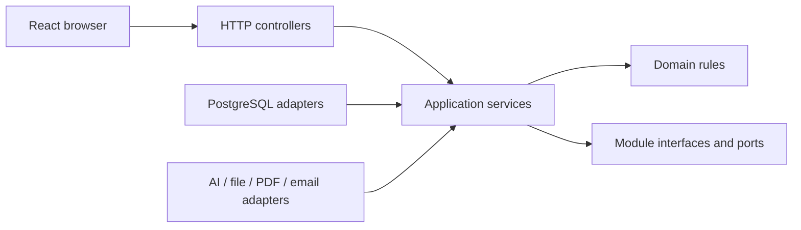
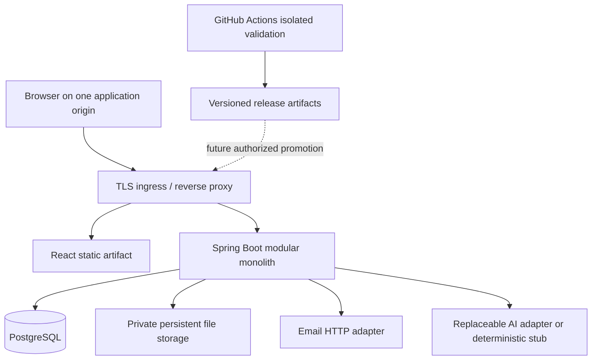

# Architecture Spine — Étaye

Review status: Draft for complete design planning. New technical choices below are **Proposals**, not approval by Aymen. The framework's `draft` status does not express implementation readiness. No application has been scaffolded. Decision rationale and alternatives live in [ADRs](../../decisions/README.md).

## Design Paradigm

One Spring Boot deployment and one React client. Business modules own their data and application services; controllers and provider adapters depend inward. Modules communicate through explicit application interfaces and immutable events, never another module's repositories. PostgreSQL is the transactional authority. Separate external ports for AI, files, PDF rendering and email allow deterministic replacements.

## Invariants & Rules

### AD-1 — Scope and development gate [ADOPTED]

- **Binds:** all.
- **Prevents:** planning completion being interpreted as authorization to build.
- **Rule:** Use Spring Boot, React with TypeScript and PostgreSQL. Use fictional demonstration data only. Implementation, migrations, application pipeline and deployment require a later explicit authorization by Aymen after complete design review.

### AD-2 — Domain ownership

- **Binds:** all domains.
- **Prevents:** duplicate ownership, hidden writes and incompatible aggregates.
- **Rule:** `identity` owns accounts, sessions and token redemption; `practices` owns memberships and practitioner profiles; `records` owns practice patients, facts and source revisions; `scheduling` owns availability and appointments; `consultations` owns encounters and note drafts; `documents` owns authored content/version/review/publication; `ai` owns jobs and provider attempts; `files` owns stored bytes and grants; `communications` owns outbox delivery; `audit` owns append-only events. A transaction may call a public module service to perform a guarded mutation. Cross-module IDs and state transitions follow the documentary contracts.

### AD-3 — Identity and isolation

- **Binds:** FR-001 through FR-018.
- **Prevents:** client-selected tenancy, administrator clinical access and connection-pool leakage.
- **Rule:** Authenticate a global account; authorize its current active membership or verified portal link against each resource. Practice IDs in routes are selectors, never grants. All practice-owned rows carry `practice_id`; composite references prohibit cross-practice joins. Runtime database role is neither owner nor superuser and has no BYPASSRLS. Set practice context transaction-locally on the same connection as every repository operation; deny missing context. RLS and application capability checks are both required. Workers explicitly re-establish the job's practice context. See ADR-003 for account/bootstrap lookup exceptions and service accounts.

### AD-4 — Browser sessions

- **Binds:** FR-001, FR-002, FR-016.
- **Prevents:** incompatible login models and stale roles encoded in browser tokens.
- **Rule:** Browser uses an opaque server-side session cookie (`HttpOnly`, `Secure`, `SameSite=Lax`, host-only) and CSRF protection for unsafe methods, including login and logout. Session ID rotates at authentication. Resolve active grants server-side per request. Serve browser/API under one origin; do not store bearer tokens in browser storage. Revoke affected sessions after suspension/password reset. Profile and portal/clinical entry points share the account authentication authority.

### AD-5 — Facts and source lineage

- **Binds:** FR-005 through FR-008, FR-011 through FR-017.
- **Prevents:** unknown data becoming normal and corrections destroying evidence.
- **Rule:** Persist unknown, explicitly negative and positive assertions distinctly. Each clinical fact has a dated immutable revision and provenance (author/reporting party, event date, entry date, origin). Corrections append a superseding revision with a reason. Citations target a specific source revision and locator; provenance is never inferred from generated text.

### AD-6 — Independent content, task and publication states

- **Binds:** FR-011 through FR-017.
- **Prevents:** successful processing or validation exposing content to patients.
- **Rule:** Business status is `DRAFT`, `IN_REVIEW` or `VALIDATED`; processing state belongs only to an AI/export task; freshness is `CURRENT` or `STALE`; publication state is `PUBLISHED`, `REPLACED` or `WITHDRAWN`. Validated versions are immutable. Edits create a new draft; they do not alter the published version. Publication targets one validated version, record and patient audience. Clinician briefs are never publishable. Replacement atomically publishes the selected version and replaces the prior active publication. Withdrawal removes future portal/download access; downloaded copies cannot be recalled.

### AD-7 — Transactions and concurrency

- **Binds:** FR-003 through FR-018.
- **Prevents:** lost edits, double bookings and side effects from rolled-back work.
- **Rule:** Mutable aggregate writes require expected version (`If-Match`); stale writes return `412`. Booking/rescheduling additionally uses database overlap constraints for practitioner and patient, active statuses `BOOKED`/`CHECKED_IN`, half-open time ranges, plus a shared serialization boundary for availability changes. Creation and retryable commands use idempotency keys bound to account, practice, operation and body hash. Commit state, audit and outbox/job rows atomically. Send email and call AI only after commit, outside the originating transaction.

### AD-8 — Asynchronous external work

- **Binds:** FR-008, FR-013, FR-017, FR-019.
- **Prevents:** request timeouts, duplicate generation and reliance on decorative infrastructure.
- **Rule:** PostgreSQL-backed leased jobs are claimed atomically with bounded concurrency and retry policy. Only the current lease may commit an outcome. A provider retry cannot overwrite human edits or approved versions. Persist source snapshots and expected target version before generation; commit into the matching draft only or retain a separate candidate. File scanning, exports and notifications expose explicit asynchronous outcomes. No broker or mandatory paid model is required.

### AD-9 — Files and exports

- **Binds:** FR-008, FR-015, FR-016, FR-017.
- **Prevents:** static URL exposure and a print path bypassing clinical permissions.
- **Rule:** File IDs resolve through guarded metadata; no public clinical bucket or browser-supplied object key. Validate type/size, quarantine and scan before release. Export snapshots include exact content, template and source versions plus checksum. Download authorization is checked at delivery; private/no-store caching, attachment disposition and auditable download apply. Store persistent bytes outside ephemeral application disks; local private storage is an isolated-development adapter only.

### AD-10 — Contract and quality boundary

- **Binds:** all APIs and FR-020.
- **Prevents:** incompatible errors, unchecked migration changes and unverified delivery claims.
- **Rule:** REST `/api/v1`, UUID identifiers, ISO dates, UTC instants with IANA practice time zone, decimal strings with units, RFC 9457 problem responses. Applied Flyway versioned SQL migrations are immutable. Test isolated real PostgreSQL and real HTTP/UI stack, stubbing only external AI/email/file scan boundaries where necessary. Publish immutable artifacts identified by commit and digest only after required checks pass; no rebuild during promotion.

## Consistency Conventions

| Concern | Convention |
|---|---|
| Namespace | Technical name `etaye`; future Java namespace `dev.aymen.etaye` (Proposal); public name Étaye |
| Storage vs API | snake_case relational names; camelCase JSON and English technical identifiers |
| Record vs identity | `Patient` is practice-local identity; `PatientRecord` is its longitudinal record; `Account` authenticates; `PortalLink` grants access |
| HTTP | `404` for another practice/inaccessible record; `403` for forbidden action on a visible resource; `409` business conflict; `412` stale version; `422` semantic validation; `428` absent precondition |
| Dates | Unknown event date is explicit; never replace it with entry date. Render locale separately from storage. Appointment instants and originating time zone are retained |
| Pagination | Cursor ordering with UUID tie-breaker; default 25, maximum 100; allowlisted filters/sorts only |
| Output | French interface preserved; English documentation; localization keys and `Intl` formatting planned, English demo decision still open |

## Stack

Seed only, verified 2026-11-02. Pin supported patch releases and container digests during authorized setup; this document does not imply installed application dependencies. Framework-managed dependencies follow the Spring Boot BOM.

| Name | Version |
|---|---|
| Java LTS | 25 |
| Spring Boot | 4.1.2 |
| React | 19.3.0 |
| Vite | 8.0.0 |
| PostgreSQL | 18.6 |
| Node.js LTS | 26 |

The `8.0.0` Vite seed identifies the verified stable major release; refresh its supported patch before setup. TypeScript, Radix Primitives, Vitest, Playwright, Flyway, Testcontainers and PDFBox are evaluated in [ADR-002](../../decisions/ADR-002-stack-and-tooling.md), with exact lock versions intentionally a future setup task.

## Structural Seed

No directories below are created in this mission. Future seed: `apps/api`, `apps/web`, `infra/local`, `docs`. Development, CI, preview and public demo use different database credentials, stores and synthetic datasets; a test never points at the public demo database. A separate Cloudflare showcase may be static; browser sessions require same-origin application routing, not unrelated free subdomains. See the [hosting assessment](../../operations/hosting-cost-assessment.md) for this constraint.

## Capability → Architecture Map

| Capability | Owning module / boundary | Governing decisions |
|---|---|---|
| FR-001 | identity | AD-3, AD-4 |
| FR-002, FR-003 | practices | AD-2, AD-3 |
| FR-004 through FR-008 | records / files | AD-3, AD-5, AD-9 |
| FR-009 | scheduling | AD-3, AD-7 |
| FR-010 | records / scheduling | AD-3, AD-5 |
| FR-011 through FR-015 | consultations / documents / ai | AD-5 through AD-8 |
| FR-016 | portal projection of authorized domain services | AD-3, AD-4, AD-6, AD-9 |
| FR-017, FR-018 | communications / files / audit | AD-7, AD-9 |
| FR-019, FR-020 | demo administration / delivery | AD-1, AD-8, AD-10 |

## Deferred and open decisions

- Provider/storage/vendor selection and paid always-on capacity require budget approval and benchmark evidence before deployment. Port contracts and same-origin requirement are fixed now.
- Real-model choice and paid credentials are unnecessary for design; select and evaluate only after authorized implementation.
- Exact patch lockfiles, Maven wrapper and source scaffolds wait for development authorization. No scaffold command is verified.
- Representatives/minors, narrower clinical record assignments and identity proof beyond the adult synthetic demo need product decisions before expanding scope; do not weaken the current boundaries.
- Intelligent laboratory PDF extraction is a later increment with mandatory extraction review; ordinary upload/manual labs remain in the current scope.
