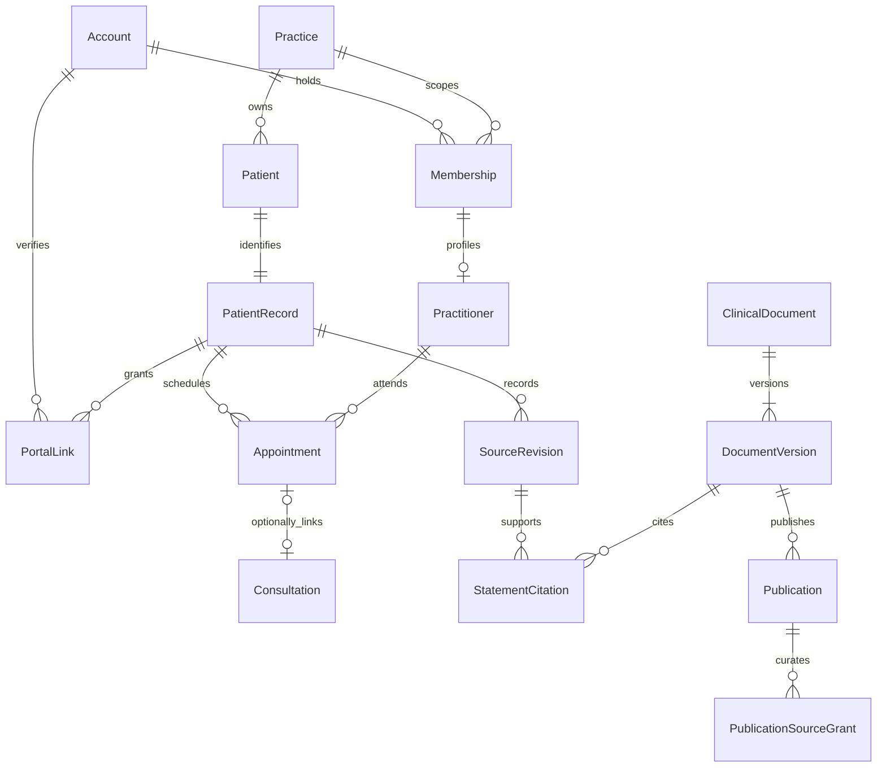

# Data model and integrity contract

Status: Proposed logical model, ready for design; no schema/migration has been implemented. 2026-11-02. [Business rules](business-rules.md) own state vocabulary; [ADRs](../decisions/) explain choices. [Data dictionary](data-dictionary.md) owns field constraints.

Every practice-owned entity carries `practice_id`; every FK to another practice-owned entity is composite `(practice_id, id)` or is checked by an equivalent database integrity constraint. Clinical resources also retain record ownership. Server repositories require an authorized context; PostgreSQL RLS is defense in depth in the same transaction under a nonowner role. Global Account does not make Patient or PatientRecord global. No client-selected identifier establishes authority.

## Cardinalities

- Account 1→0..N Membership; Practice 1→0..N Membership; unique account/practice pair. Membership 1→0..1 Practitioner. Active account does not imply active membership.
- Practice 1→0..N Patient; Patient 1→1 PatientRecord. Account 1→0..N PortalLink; each adult record 0..1 active self-link [ASSUMPTION]. No automatic cross-practice identity matching.
- Practitioner 1→0..N AvailabilityRule/Exception and Appointment. PatientRecord 1→0..N Appointment/VisitPreparation/Consultation. Consultation links 0..1 Appointment; one appointment can link at most one active encounter.
- PatientRecord 1→0..N SourceRevision, ClinicalAssertion, Measurement, LabResult and RecordDocument. SourceRevision may supersede 0..1 prior revision of same record; one current branch is selected explicitly.
- ClinicalDocument 1→1..N DocumentVersion; each version has 0..N citations and review events. Citation references exactly one immutable source revision with locator; many citations can support one statement.
- DocumentVersion 1→0..N historical Publication records, each for one exact audience link. A Publication has 0..N curated source/attachment grants. At most one current PUBLISHED projection per logical document/audience.
- Domain mutation 1→0..N OutboxEvent and 1..N applicable AuditEvent; task has 0..N attempts internally and 0..1 committed result. ExportArtifact refers to exact version/template and optional publication.

## Transactions and historical correction

Appointment booking/rescheduling uses exclusion constraints for practitioner and patient active ranges plus serialization shared with availability edits. Guard mutable aggregate version with If-Match. Canonical transport: 412 stale write, 409 business overlap/idempotency conflict, 428 missing precondition. A cancellation/no-show does not delete notes or create a consultation. Half-open ranges allow adjacency. Timezones and DST choices survive rescheduling history.

Commit domain state, required successful audit, idempotency outcome and outbox/job atomically. External AI/email/storage work is outside the request transaction. Worker claims use row locks/leases and fencing token; at most current lease commits. Recheck requester capability/resource scope before input retrieval and result publication. A revoked request never expands access through a worker.

Clinical corrections append immutable revisions with reason/actor/date. Document versions preserve generated baseline, human changes and cited source versions. Reviewed/validated text is never silently replaced; publication references exact immutable content. Relevant source changes mark dependents STALE without overwriting them. Withdrawal/replace revokes future portal/download grants, not already-downloaded files.

## Storage types and deletion

UUID keys, PostgreSQL timestamptz for instants, date for birth/uncertain date-only events, IANA timezone separately, numeric decimals for measurements, text/code for original units. API decimals are strings to avoid binary precision loss; numerical storage and display formatting differ. Unknown event time has explicit precision/status; upload time is separate.

Mutable operational entities have created_at/updated_at/actor and version. Immutable revisions/events have created/occurred time, source/actor and checksum as appropriate. Apply lifecycle status instead of routine destructive deletion of history. Hard-delete belongs only to a documented demo reset/retention operation with referential ordering; no broad cascading deletion of clinical evidence. Applied migrations are immutable Flyway SQL and future clean/upgrade checks validate constraints. No migration is written in this mission.
